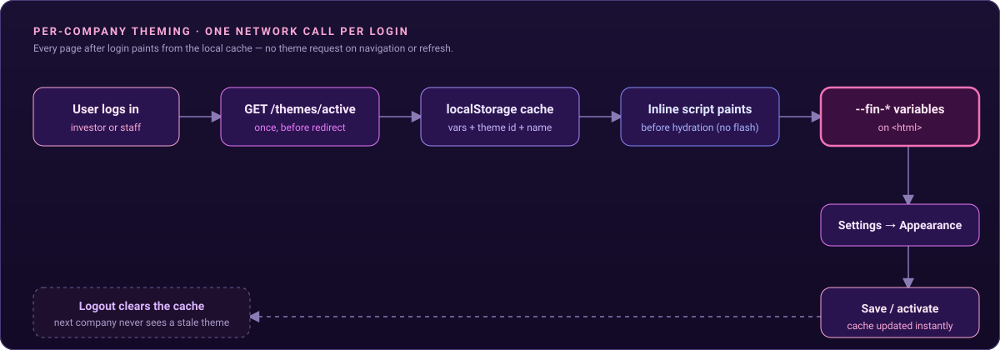
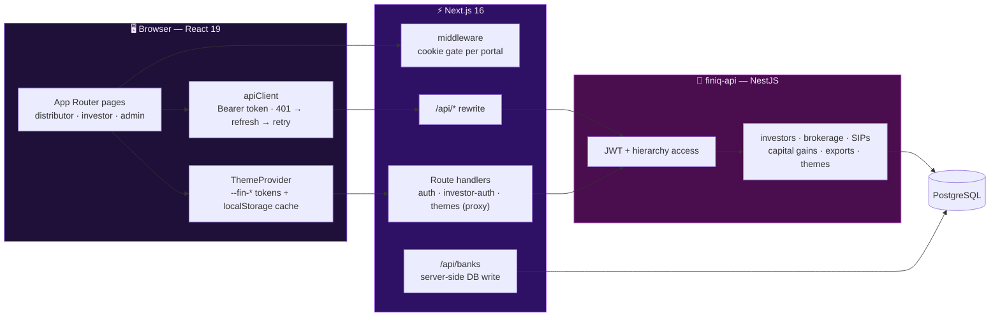

<div align="center">


<br/>

[](#-tech-stack)
[](#-tech-stack)
[](#-tech-stack)
[](#-tech-stack)
[](#-per-company-theming)
[-e0234e?style=flat-square)](https://github.com/Sp2736/finiq-api)

**One white-label portal for mutual fund distributors, their sub-broker networks, and their investors — with every screen scoped to who is looking at it, and every company wearing its own brand.**

</div>

---

## What is FinIQ?

FinIQ is a **B2B2C WealthTech SaaS platform** for mutual fund distributors. A distribution company onboards onto the platform, maps its investors to a hierarchy of brokers and sub-brokers, and gets a single place to see **AUM, holdings, SIPs, brokerage earnings and capital gains** — while its own investors get a branded self-service portal.

This repository is the **web frontend**. It talks to the NestJS service in [`finiq-api`](https://github.com/Sp2736/finiq-api), which owns the data, the multi-tenant access rules and the report generation.

It is organised around three entry points:

| Portal | Who | What they do |
|---|---|---|
| **Distributor** `/distributor` | Company admins, brokers, sub-brokers | Overview dashboard, client holdings, investor mapping, earnings & ledger, SIP and systematic reports, user management, appearance settings |
| **Investor** `/investor` | Mutual fund investors | Portfolio and fund-level holdings, capital gains, systematic transaction reports, financial calculators |
| **Admin** `/admin` | Platform operators | Entry point for platform-level administration (company onboarding lives in the API) |

> Built during a full-stack engineering internship, including the **theme system**, the **hierarchical earnings and investor-mapping screens**, and the **server-side export** refactor described below.

<br/>

<div align="center">

<sub>Animated in a browser (GitHub renders raw SVG natively) — packets show a theme moving from the API into the cache and onto the page.</sub>
</div>

---

## Table of Contents

- [Why This Exists](#why-this-exists)
- [Architecture at a Glance](#-architecture-at-a-glance)
- [The Three Portals](#-the-three-portals)
- [Authentication & Sessions](#-authentication--sessions)
- [Per-Company Theming](#-per-company-theming)
- [Reports & Exports](#-reports--exports)
- [Financial Calculators](#-financial-calculators)
- [Tech Stack](#-tech-stack)
- [Getting Started](#-getting-started)
- [Configuration Reference](#-configuration-reference)
- [Project Layout](#-project-layout)
- [Roadmap](#-roadmap)
- [Related Repository](#-related-repository)

---

## Why This Exists

Mutual fund distribution is a hierarchy business: a company has brokers, brokers have sub-brokers, and every investor belongs somewhere in that tree. Most tools either show everyone everything or force each broker into a separate spreadsheet. FinIQ's frontend is built around three ideas:

- **Scope is the product.** A sub-broker sees their own downline and nothing else; a company admin sees the whole company. The UI renders what the API returns for the caller — it never tries to filter secrets client-side.
- **White-label by default.** Each company has its own colours, logo and look, applied before the page paints.
- **Investors are first-class.** Investors log in to their own portal with their own session type, instead of being squeezed into the staff experience.

---

## 🏗 Architecture at a Glance



- **Rewrites, not a second backend.** Everything under `/api/*` is rewritten to the NestJS service, so the browser only ever talks to one origin and there is no CORS dance in the app code.
- **Thin proxy handlers** exist where cookies and headers need to be forwarded explicitly (auth, investor-auth, themes).
- **Route protection in middleware** — each portal checks for its own auth cookie and redirects to its own login page.

---

## 🧭 The Three Portals

### Distributor portal

| Screen | What it gives you |
|---|---|
| **Overview** | Company summary and top contributors (desktop table / mobile list) |
| **Clients** | Investor list, per-client holdings, fund portfolio tab, fund analytics modal (returns, risk, sector allocation, style box), and a holdings report |
| **Investor mapping** | Assign and unassign investors to brokers and sub-brokers, with a visible mapping history |
| **Earnings** | Brokerage dashboard with global stats, brokerage tables, and a broker ledger |
| **Reports** | Hierarchy earnings, SIP report, ledger, and systematic transactions |
| **Users** | Create and manage company users and the broker hierarchy |
| **Calculators** | Six planning calculators (see below) |
| **Settings** | Appearance — the theme panel |

### Investor portal

| Screen | What it gives you |
|---|---|
| **Portfolio** | Holdings with a global stats ribbon, filters, a desktop fund table and a dedicated mobile layout |
| **Capital gains** | Modal that requests a capital-gains statement for a chosen period |
| **Systematic transactions** | SIP / STP / SWP style transaction report |
| **Calculators** | The same six calculators, with a quick-switch dropdown |

Every data-heavy screen ships **two layouts** — a dense desktop table and a purpose-built mobile list — rather than one squashed responsive table.

---

## 🔐 Authentication & Sessions

Two session types, two cookie namespaces, one API client.

| | Staff (distributor / admin) | Investor |
|---|---|---|
| **Login** | Phone number + OTP | Identifier + password |
| **Cookies** | `staff-auth-token`, `staff-refresh-token`, `staff-user-id` | `investor-auth-token` |
| **Refresh** | Yes — silent refresh on `401` | No (longer-lived token) |
| **Route gate** | `/distributor/*`, `/admin/*` | `/investor/*` |

How the client behaves:

1. `apiClient` picks the portal from the URL and attaches the matching Bearer token.
2. On a `401` for a staff session it calls the refresh endpoint **once** — concurrent failing requests share a single in-flight refresh promise, so a burst of calls can't trigger a refresh storm.
3. If the refresh fails, local state is cleared and the user is sent back to the right login page.
4. Middleware bounces already-signed-in users away from login pages, and signed-out users away from protected ones.

---

## 🎨 Per-Company Theming

Every company gets its own look. The system is built around **257 `--fin-*` CSS custom properties** covering surfaces, KPI cards, badges, charts, analysis states, sidebar and ribbons — so a theme is a data record, not a fork of the stylesheet.

- **One network call per login.** The active theme is fetched right after login and cached in `localStorage` (variables plus theme identity). Page loads, refreshes and navigation read the cache.
- **No flash of the wrong theme.** An inline script in each layout applies the cached variables to `<html>` **before hydration**.
- **Appearance panel** (Settings) — pick colours, derive a full scale from a brand colour, save named themes, activate or reset to default. The saved list is requested **only** when this panel opens.
- **Scoped live preview.** Edits preview instantly across the app and are reverted if you leave without saving.
- **Charts follow the theme** through a dedicated hook, so graphs recolour with the brand.
- **Logout clears the cache**, so the next company to sign in on the same browser never sees someone else's brand.

Company logos follow the same pattern: delivered at login, cached locally, and rendered through a shared hook.

---

## 📤 Reports & Exports

Investor and distributor reports can be downloaded as **PDF or Excel**: holdings, transaction reports, capital gains, hierarchy earnings, and systematic (SIP/STP) reports. Heavy generation runs **on the API side** rather than shipping raw data to the browser to be reshaped — the browser requests the report and downloads the finished file.

Hierarchy earnings exports are named by breakdown and period (for example *by AMC* vs *by Investor*), and use a consistent blue-family palette for header, group, striped and total rows.

---

## 🧮 Financial Calculators

Six client-side calculators, available in both the investor and distributor portals, with Indian-locale currency formatting and Recharts visualisations:

| Calculator | Purpose |
|---|---|
| **Goal planner** | How much to invest to reach a target |
| **MF returns** | Projected value of SIP / lump-sum investments |
| **STP** | Systematic transfer plan outcomes |
| **SWP** | Systematic withdrawal plan outcomes |
| **FD** | Fixed-deposit maturity |
| **Reverse EMI** | Loan affordability from a target EMI |

---

## 🛠 Tech Stack

| Layer | Technology |
|---|---|
| **Framework** | Next.js 16 (App Router, route handlers, middleware, rewrites) · React 19 · TypeScript |
| **Styling & motion** | Tailwind CSS v4 · CSS custom-property design tokens · Framer Motion · Lucide icons |
| **Data viz** | Recharts |
| **Documents** | ExcelJS · jsPDF + AutoTable |
| **Sessions** | `js-cookie` + native cookies · custom fetch client with refresh-and-retry |
| **Server-side DB access** | `pg` (one narrow route handler) |
| **Tooling** | ESLint 9 · `next dev --webpack` on port 3001 |

---

## 🚀 Getting Started

**Prerequisites:** Node.js 20+, and the [`finiq-api`](https://github.com/Sp2736/finiq-api) service running locally on port **3000**.

```bash
git clone https://github.com/Sp2736/finiq.git
cd finiq

npm install
cp .env.example .env.local     # fill in the values below
npm run dev                    # http://localhost:3001
```

```bash
npm run build     # production build
npm run start     # serve the build
npm run lint      # ESLint
```

> The dev server runs on **3001** so it doesn't collide with the API on 3000. `/api/*` requests are rewritten to `http://localhost:3000` — change the destination in `next.config.ts` to point at a deployed API.

---

## 🔧 Configuration Reference

| Variable | Purpose |
|---|---|
| `NEXT_PUBLIC_API_URL` | Base URL the auth/theme proxy handlers forward to (defaults to `http://localhost:3000`) |
| `DATABASE_URL` | Postgres connection string, used only by the server-side bank-account route handler. The app refuses to start that route without it — there is no hardcoded fallback |

---

## 📁 Project Layout

```
finiq/
├── src/
│   ├── app/
│   │   ├── (auth)/                  # login · distributor-portal · admin-portal
│   │   ├── distributor/             # overview · clients · earnings · investor-mapping
│   │   │                            # reports (hierarchy · sips · ledger · systematic) · users · calculators · settings
│   │   ├── investor/                # portfolio · calculators · reports
│   │   ├── admin/
│   │   └── api/                     # proxy handlers: auth · investor-auth · themes · banks
│   ├── components/
│   │   ├── distributor/             # dashboards, brokerage tables, client views, fund analytics
│   │   ├── investor/                # holdings tables, filters, capital gains modal
│   │   ├── settings/                # ThemePanel · ThemePreviewPane · pickers
│   │   ├── layouts/                 # auth forms, animated backgrounds, role selector
│   │   └── ui/                      # shared notices
│   ├── context/ThemeContext.tsx     # theme state, cache, preview/revert
│   ├── services/                    # auth · distributor · investor API wrappers
│   ├── lib/                         # apiClient · authClient · export helpers · colour utils
│   ├── hooks/                       # usePortfolio · useCompanyLogo · useChartTheme
│   └── middleware.ts                # per-portal cookie gate
├── *.md                             # design notes: theme storage, token editing, hierarchical data loading
└── next.config.ts                   # /api rewrite to the NestJS service
```

---

## 🗺 Roadmap

- [x] Three-portal structure with per-portal cookie gating
- [x] Staff OTP login with single-flight silent refresh; investor password login
- [x] Hierarchy-aware dashboards, client holdings and fund analytics
- [x] Investor mapping with history
- [x] Hierarchy earnings, SIP, ledger and systematic reports
- [x] Six financial calculators
- [x] Token-based per-company theming with cached, flash-free paint
- [x] Server-side PDF/Excel exports
- [ ] Flesh out the admin portal beyond its entry page
- [ ] Move the bank-account write behind the API instead of a direct database connection
- [ ] Point the `/api` rewrite at an environment variable instead of a hardcoded host
- [ ] Mark auth cookies `Secure` in production and evaluate `HttpOnly` token storage
- [ ] Component and end-to-end tests for the auth refresh flow and the theme cache

---

## 🔗 Related Repository

| Repo | Role |
|---|---|
| [`finiq-api`](https://github.com/Sp2736/finiq-api) | NestJS backend: multi-tenant access control, RTA data, brokerage distribution, capital gains, caching and exports |

<div align="center">
<sub>Brand it, scope it, ship it.</sub>
</div>
